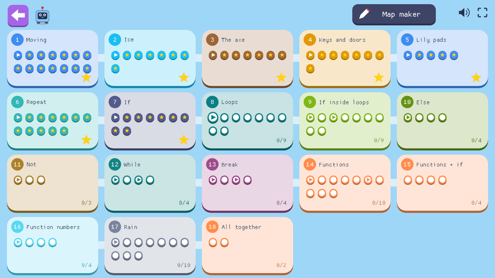
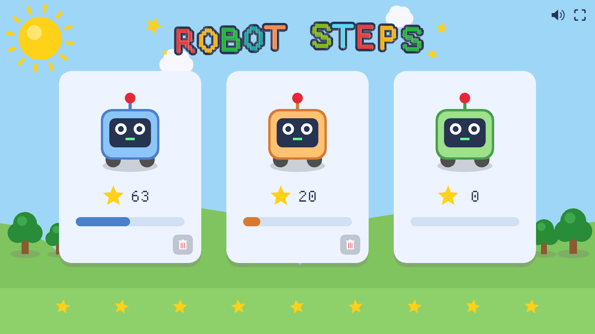
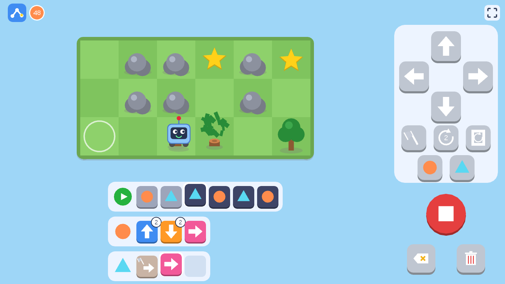
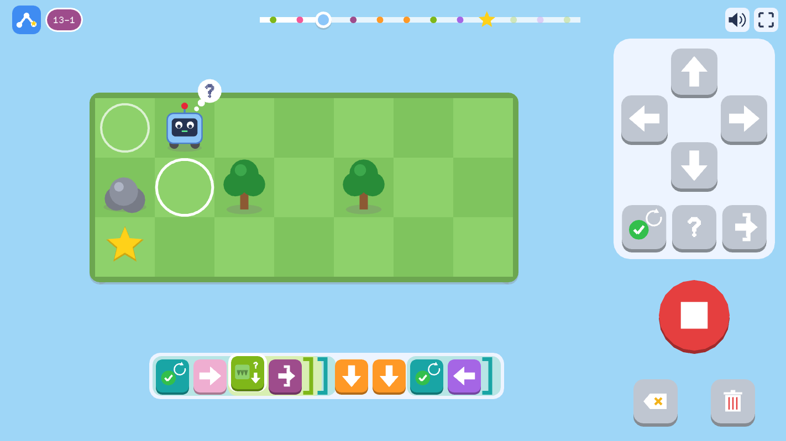

# Robot Steps

A first coding game for young children (made for a 5-year-old). Tap arrows to
build a program, press play, and watch the robot follow it to collect the
stars. There's no reading required.

**[Play it in your browser](https://plwg.github.io/robot-steps/)**

| Choose a player | Playing a level |
|---|---|
|  |  |

## What it teaches

Across 108 levels in 18 chapters, numbered within each chapter (`3-2`), it
introduces the ideas of programming in the order they're usually taught,
each as something a robot on a map can do.

| Programming idea | In the game | Chapter |
|---|---|---|
| A program is a sequence of steps | Arrow blocks, run in order from the left | 1 Moving |
| Thinking ahead about state | Ice slides until something stops it; keys are carried and used up; a lily pad sinks once crossed | 2 Ice, 4 Keys and doors, 5 Lily pads |
| Commands that change the world | The axe chops a tree down (and chopping nothing is an error) | 3 The axe |
| Doing something n times | A count on a block: "go right ×3" | 6 Repeat |
| Conditionals (`if`) | Mystery clouds turn out differently each run: "if there's a tree to the right { chop it }" | 7 If |
| Loops (`for` n times) | Brackets round a group of blocks, with a count | 8 Loops |
| Nesting | An "if" inside a loop: one rule for whatever comes | 9 If inside loops |
| `if` / `else` | An "if" splits in two: the yes blocks along the top, the "otherwise" blocks in a grey lane underneath | 10 Else |
| Negation (`not`) | A crossed-out choice: "if there's *no* tree" | 11 Not |
| `while` loops | "While there's grass to the right { go right }", looking before each time round | 12 While |
| `while true` and `break` | "While true" (a tick) goes round until a break (a doorway with an arrow going out) leaves the loop | 13 Break |
| Functions | Strips named ● and ▲ that the main program calls | 14 Functions, 15 Functions + if |
| Parameters | Call ● with a number, and use "●'s number" as a count inside it | 16 Function numbers |
| Timing | Rain clouds rain on a cycle: sleep, or hurry | 17 Rain |
| Infinite loops | A "while" that would never end stops and shakes red | 12 While |
| Tracing a program | The slider along the top runs it ahead of time, step by step | Throughout |
| Debugging | The step that went wrong shakes red; blocks can be put in or taken out anywhere | Throughout |
| Optimising | A trophy for the fewest blocks, and for the fewest turns | Throughout |

## The chapters

1. **Moving:** up, down, left and right, in order
2. **Ice:** the robot slides until grass, a rock or the edge stops it, so it
   has to think ahead about where it will end up (and sometimes go the long
   way round)
3. **The axe:** chop down trees (but not rocks)
4. **Keys and doors:** a locked door needs a key, and each key opens one
   door. The robot remembers what it's carrying, so the order matters: fetch
   the key first, even when it's the other way
5. **Lily pads:** a lily pad holds the robot once, then sinks behind it.
   There's no going back the same way, so plan the way round (and which
   island to leave till last)
6. **Repeat:** run one block several times when there aren't enough slots
7. **If:** mystery clouds become a tree or grass each run (any way at all:
   all trees, all grass, or a mix), so the robot has to look before it
   chops. The clouds are tricky: if there's a way to turn out that beats
   the program, that's the way they go, so a program that only works when
   it's lucky never wins. Tap "if", pick what to look for (shown as map tiles: a tree, rock,
   star, ice, key, door, grass, or the edge of the map, whichever the level
   offers), then which way. The blocks to run go inside its brackets
8. **Loops:** repeat a whole group of blocks
9. **If inside loops:** "if there's a tree to the right { chop it }" or "if
   there's a star above { fetch it }" in a loop: one rule handles whatever
   the robot finds, wherever it finds it
10. **Else:** "if there's a tree to the right { go down } otherwise { go
    right }"
11. **Not:** "if there's *no* tree above { fetch the star }"
12. **While:** "while there's grass to the right { go right }". Pick what to
    look for, like an "if", then which way. The clouds decide how far it is,
    so no fixed count would do. With "not": "while there's *no* tree below
    { go down }". "While true" (a tick) is always one of the choices: it
    keeps going until the last star, or a break
13. **Break:** "while true { go right; if there's grass below { break } }".
    A break leaves a counted loop early too. These levels have no counts, so
    going the long way round doesn't fit
14. **Functions:** extra strips of blocks named with a shape (● and ▲) that
    the main program calls whenever it needs them
15. **Functions + if:** "if" blocks inside functions
16. **Function numbers:** call ● with a number (set with repeat), and
    inside it a count can be "●'s number" instead of a fixed one, so one
    function makes stairs of 1, 2 and 3
17. **Rain:** rain clouds count down 3, 2, 1 (the number's on the cloud),
    rain for 2, then start again. A row under each cloud shows its whole
    cycle (a dot for each dry tick, a drop for each tick of rain, with the
    one it's on now ringed). Every action takes a tick, and the weather
    showing is the weather for the next one: stepping under a dry cloud is
    safe, even on its last dry tick, but staying under it for an action
    while it rains is getting wet, and the end of the run. It can't be
    walked into while it's raining, so sleep (the sleep block, Zzz) until
    it stops, or hurry across before it starts
18. **All together**

Each new block is first shown in a demo level (▶ on the map): the program is
already written (with just enough room for it), so just press play and
watch how it's used. Then each new tool starts on a map from earlier in the
game, with too few slots to solve it the old way, before moving on to new
maps.

## Playing

- **The slider** along the top runs the program ahead of time, while it's
  being built. Drag it to see where the robot would be before any step, with
  the block about to run lifted up. A star marks each step that picks one
  up, a red cross the step that bumps into something, and blue the steps
  when it's raining. The end shows how it would finish (a star, a cross or
  rain), right where the run stops, with the rest of the program faded
  after it. Play always runs from the start, picks the mystery clouds again,
  and the slider follows that run.
- **Fewer buttons:** blocks that only make sense inside another one are in a
  second menu. Tapping "if" shows what it can look for, each also crossed
  out for "not" (with more than five choices, "not" is a button of its own
  instead); tapped while an "if" is open, it shows "otherwise" (a fork) and
  the end of the "if" (`]`). Loops and "while" do the same, with break (a
  doorway with an arrow going out).
- **Split tracks:** an "if" with an "otherwise" splits in two: the blocks
  for yes along the top on green, and the blocks for no in a grey lane
  underneath, both ending at one tall `]`.
- **Debugging:** when the robot bumps into something, the step that went
  wrong shakes red, and the program stays put to be fixed. Tapping a block
  opens an empty slot before it for a missing step, and the eraser that
  appears on a block takes it out.
- **Sound:** every action has one, and each direction plays its own note,
  so a program plays a little tune. The speaker in the corner turns it off.
- **Players:** three, each with their own robot colour and progress. The
  level map shows each chapter as an island, with its levels as dots:
  filled in with a star once finished, a play sign for a demo, and the next
  one pulsing. Tapping a dot plays that level; tapping anywhere else on an
  island plays its first level not done yet.
- **Bests:** each win shows the blocks used and the turns taken, with a
  trophy by any new best. A finished level has a trophy next to its number:
  tap it to see the bests, then play again to beat them.
- **Pointer and touch:** the game draws a big, easy-to-spot pointer, and
  resting it on a button shows its name. Played by touch, there's no
  pointer. On a phone held upright, the game is drawn on its side to fill
  the screen (turn the phone to play), and on a small screen the program's
  tiles are bigger, to be easier to tap.

## Making maps

The **Map maker** button at the top of the level map opens everyone's maps.
Tap the green **+** to start one, then pick a tile on the right (grass,
tree, rock, ice, water, lily pad, mystery cloud, key, door, rain cloud, star
or the robot) and tap or drag across the map to paint it. Tapping a rain
cloud again moves where it starts in its cycle. Under the map, − and +
change its width and height and how many slots the program (and each
function) has.

The buttons under the tiles choose the blocks it allows: the axe, sleep,
repeat, loops, "while", "if", the two functions and numbers for them, and
break. Tapping "if" (or "while") turns it on and shows its options where the
tiles were: what it can look for (a tree, rock, star, ice, key, door, grass,
the edge, or "true", each on or off), whether it can be "not" ("if there's
*no* tree"), and for the "if", whether there's an "else". The × goes back to
the tiles, and tapping the block again while its options show turns it off.
Some blocks bring others along, as in the game's own levels: loops need
repeat; "while" and functions need loops; numbers need a function; and break
needs a loop and an "if". Mystery clouds always come with "if" (looking for
a tree, at least) and the axe, and rain clouds with sleep.

Press play to try the map out. The arrow at the top left goes back to
everyone's maps, where a map can be played, changed with the pencil, or
thrown away by tapping its bin twice. There's room for 128, eight to a
page, with arrows either side to turn the pages. Empty slots (a +) fill the
rest of the last page, and there's always one more page of them after it:
tapping any of them starts a new map, after the others. They're shared by all
three players, and finishing one doesn't count towards a player's levels.

## More

- [Building and running](docs/BUILDING.md): Linux, Windows, the web
  version, and how the levels are written and tested
- [Keyboard shortcuts](docs/KEYBOARD.md), for grown-ups
